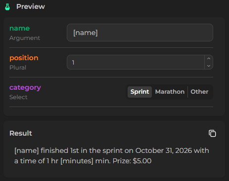
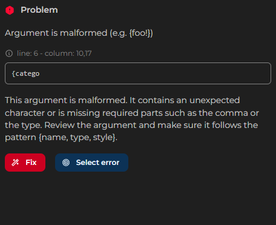
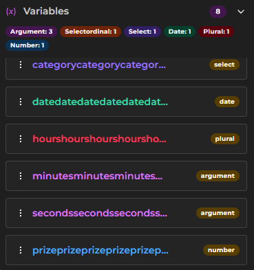
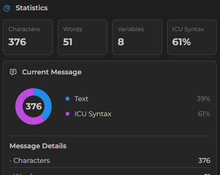

**A blazing-fast desktop IDE designed to simplify working with ICU MessageFormat.**

 

We've supercharged ICU Studio with powerful widgets, smarter previews, and a completely revamped copy system to make your i18n workflow faster than ever.

### 📋 4-Way Smart Copy System
Stop wrestling with formatting. Copy your messages exactly how you need them:
- **Single-line Copy:** Strips all line breaks for quick pasting.
- **Translator Function:** Copies as `t('', { variable })` format.
- **JSON Property:** Copies as `"": "message {variable}",` ready for your JSON files.
- **Plain Text:** Copies the raw text without any formatting.

### 🧩 Powerful Built-in Widgets
Everything you need to perfect your messages, right at your fingertips.

- **🚑 Error Manager:**
  - Human-readable error explanations.
  - One-click **Quick Fix** buttons to resolve syntax issues instantly.
  - Precise error highlighting to show exactly where the problem is.
- **📊 Message Analyzer:**
  - Real-time character, word, and variable counts.
  - ICU Syntax vs. Plain Text ratio (percentage).
  - Count of `plural`/`select` branches and tags.
- **👁️ Smart Live Preview:**
  - Real-time rendering of your message with variable testing.
  - **Smart Inputs:** Dynamic inputs based on variable types (e.g., a beautiful Date Picker for `{dateVariable, date, short}`).
  - Copy the final rendered output with one click.
- **🔤 Variable Manager:**
  - Overview of all variables in your message.
  - Bulk or single selection to **delete**, **duplicate**, **copy**, or **cut** variables.
  - Convert variable types in bulk or individually.
  - Smart selection of the entire variable block (from opening to closing brace).
- **🌳 Tree Outline:**
  - A clear, hierarchical tree view of your entire message structure.

### ⚡ Other Improvements
- **Ready-to-use Snippets:** Insert complex variables (Date, Time, Plural, Select, etc.) with a single click.
- **Keyboard Shortcuts:** Navigate and edit faster with dedicated hotkeys.
- **Undo/Redo:** Seamless history tracking for a frictionless editing experience.
- **Dark Theme:** A sleek, eye-friendly dark mode built for developers.

 

 

## 📸 Screenshots

<table width="100%" style="border-collapse: collapse; border: none;">
  <tr>
    <td width="50%" align="center" valign="top" style="border: 1px solid #30363d; padding: 20px; vertical-align: top;">
      <h3 style="margin-top: 0;">Smart Live Preview</h3>
      
    </td>
    <td width="50%" align="center" valign="top" style="border: 1px solid #30363d; padding: 20px; vertical-align: top;">
      <h3 style="margin-top: 0;">Error Manager & Quick Fixes</h3>
      
    </td>
  </tr>
  <tr>
    <td width="50%" align="center" valign="top" style="border: 1px solid #30363d; padding: 20px; vertical-align: top;">
      <h3 style="margin-top: 0;">Variable Manager</h3>
      
    </td>
    <td width="50%" align="center" valign="top" style="border: 1px solid #30363d; padding: 20px; vertical-align: top;">
      <h3 style="margin-top: 0;">Analyzer</h3>
      
    </td>
  </tr>
</table>

## 🤝 Contributing

We welcome contributions from the community! Whether it's fixing a bug, adding a new feature, or improving documentation, every bit helps.

### Need help?

Open an issue or start a discussion—we're here to help! 💬
